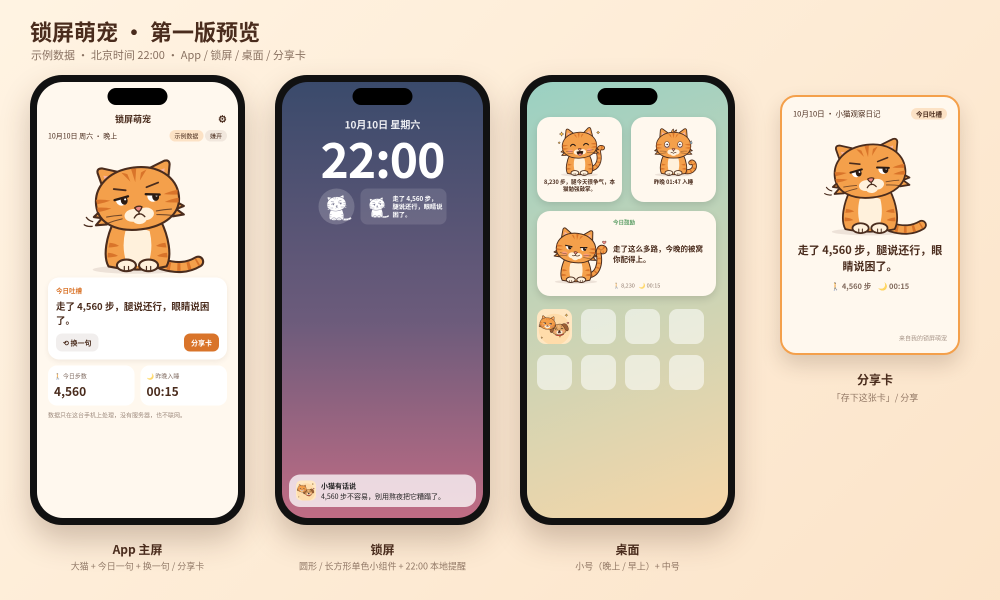

# 锁屏萌宠 · lockscreen-cat

住在 iPhone 锁屏上的小猫 / 小狗：读你的**步数**和**睡眠**，按当天数据换表情，每晚给你一句旁白——该嫌弃就嫌弃，该夸就夸。

- SwiftUI + WidgetKit + HealthKit，iOS 17+
- 完全离线：只读健康数据，不联网、没有服务器、零第三方依赖
- 免费 Apple ID 即可用 Xcode 侧载到自己手机
- 句库：猫狗各 560 句（吐槽 + 鼓励）

## 安装

详细步骤见 [LockscreenCat/README.md](LockscreenCat/README.md)（打开工程、改 Bundle ID、签名、装到 iPhone、添加锁屏小组件）。补充说明见 [docs/install.md](docs/install.md)。

## 目录

| 路径 | 内容 |
| --- | --- |
| `LockscreenCat/` | iOS 工程（App、Widget、Shared、Config、art） |
| `assets/` | 角色插画、预览图、配色说明 |
| `tools/` | 插画 / 图标 / 工程文件生成脚本、逻辑测试，以及句库生成与校验脚本（build*.py、validate_all.py） |
| `docs/` | 安装说明（install.md）、文案说明（copy.md）、评审记录（review.md） |

## 说明

个人非商业项目，仅供学习和自用。
